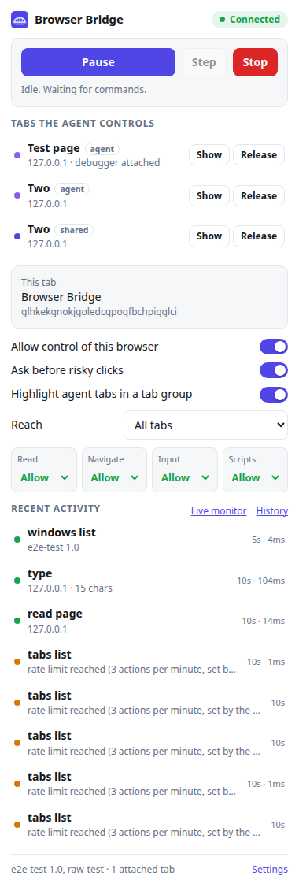
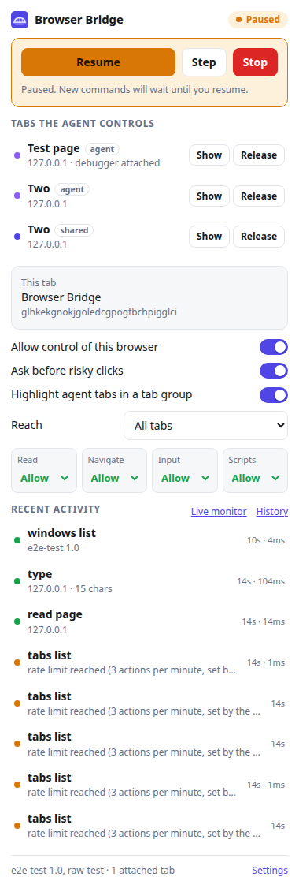
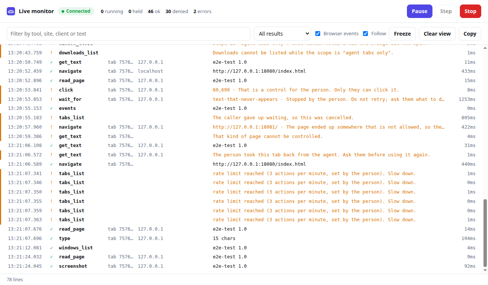
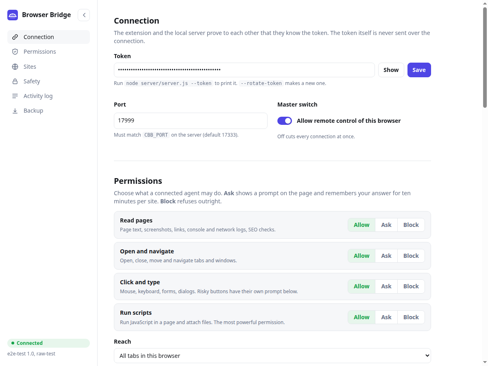

<p align="center"></p>

<h1 align="center">Browser Bridge MCP</h1>

<p align="center">
  Let any local MCP client drive your own Chrome or Chromium, with you holding the brakes.<br>
  No cloud account, no login, works in the browser profile you already use.
</p>

```
MCP client  <--stdio-->  server/server.js  <--authenticated ws://127.0.0.1:17333-->  extension (service worker)
```

<p align="center">
  
  &nbsp;
  
</p>

## What you get

**Power**

- **44 tools** for tabs, windows, reading, input, structured extraction, monitoring, SEO checks and human hand-off.
- **Parallel by design.** Commands for different tabs run at the same time, commands for one tab run in order.
  `tabs_open_many` opens dozens of pages at once, `batch` runs many operations in one call, and background tabs
  keep rendering, so one task can work several sites at once.
- **Real input.** Trusted clicks and keystrokes through the Chrome debugger API, shadow DOM and same-origin iframes.
- **Structured reads.** `extract` returns table rows or selector matches as data. `screenshot` can capture one element.
  `wait_for` waits on text, a selector or the URL. `emulate` switches viewport, mobile mode and user agent.
- **Whole-browser view.** An `events` timeline of new tabs, popups, navigations, dialogs, downloads, HTTP errors and CAPTCHAs,
  plus per-tab console and network capture.
- **Workflow prompts** for SEO audits, brand checks, social posting and form filling (see `docs/workflows.md`).

**Control**

- **Pause, Step, Stop.** Pause holds every new command until you resume. Step lets one through. Stop halts everything,
  detaches from all tabs and revokes approvals. Available in the popup, on a pill shown on controlled tabs, and with
  `Alt+Shift+P` (pause or resume) and `Alt+Shift+X` (stop).
- **Permissions.** Read, navigate, click and type, run scripts: each Allow, Ask or Block. Scripts default to Ask.
- **A settings page that stays out of the way.** The sidebar folds into an icon rail (button or the `[` key) and remembers it.
- **Reach.** Limit the agent to tabs it opened itself. Share a tab of yours with one switch.
- **Sites.** Allow-list and block-list. `javascript:` and `data:` are never navigated to, `file://` is blocked by default.
- **Approvals** for risky clicks (Post, Send, Submit, Delete, Pay and your own words), a CAPTCHA lock that never solves
  a challenge, an action-per-minute limit, and a master off switch.
- **Always visible.** Tabs the agent opens are collected in a purple **Bridge** tab group (it turns orange while paused). Your own
  tabs join the group only while the agent is using them and leave afterwards; tabs already in your groups stay put. A pill and a
  coloured frame appear on controlled pages, the toolbar badge counts controlled tabs, and the popup lists them with Show and Release.
- **Realtime logging.** A live monitor page streams every command the moment it starts (running, held, ok, denied, error) together
  with browser events, with filters, Freeze and Copy, and Pause or Stop right there. The popup and settings page update live too.
  On the server, `node server.js --follow` tails calls in a terminal and `CBB_LOG=1` prints each call as it happens.
- **Activity log** in the popup and settings page, exportable as JSON or CSV, plus a server-side audit file.

<p align="center"></p>

<p align="center"></p>

## Security at a glance

- Server binds to `127.0.0.1` only. **Mutual HMAC authentication**: the token is never sent, and the extension refuses a
  server that cannot prove it knows the token.
- Web-page origins and wrong `Host` headers (DNS rebinding) are refused, failed attempts are throttled, and the
  extension id is pinned on first use.
- The agent cannot approve its own prompts or press the pill: closed shadow roots, trusted real clicks only, not reachable
  by keyboard, and automated clicks aimed at them are refused.
- Typed text, key presses and form values never reach a log. `upload_file` refuses relative paths and credential files, and
  `fetch_url` refuses your local network unless you allow it.

Read the full model, including its limits, in [docs/security.md](docs/security.md).

## Requirements

- Node.js 18 or newer
- Chromium or Chrome 114 or newer (any Chromium browser with Manifest V3)

## Install

```bash
git clone https://github.com/himaldahal/browser-bridge-mcp.git
cd browser-bridge-mcp/server && npm install
node server.js --token        # prints your secret token
```

1. Open `chrome://extensions`, enable Developer mode, choose **Load unpacked**, select the `extension/` folder.
2. Click the extension icon, open **Settings**, paste the token, press Save.
3. Register the server with your MCP client as a stdio server:

   ```
   node /absolute/path/to/browser-bridge-mcp/server/server.js
   ```

4. Start the client. The popup shows **Connected** and the toolbar badge shows **ON**.

Upgrading from 2.x: reload the extension and restart the MCP client together. The handshake changed, and the old
extension cannot talk to the new server.

### Server options

| Command | What it does |
| --- | --- |
| `node server.js --token` | Print the token |
| `node server.js --rotate-token` | Replace the token, then paste the new one into the extension |
| `node server.js --reset-pin` | Forget the pinned extension (after loading it from a new folder) |
| `node server.js --audit 50` | Show the last 50 audit entries |
| `node server.js --follow` | Watch calls live (`--json` for raw lines) |
| `node server.js --hub-only` | Host the connection without an MCP client (for a background service) |

`CBB_PORT` changes the port (set the same port in the extension settings). `CBB_LOG=1` makes the server print every call to stderr as it happens.

## Tools

| Group | Tools |
| --- | --- |
| Overview | `status`, `events`, `reload_extension` |
| Tabs and windows | `tabs_list`, `windows_list`, `window_create`, `window_close`, `tab_create`, `tabs_open_many`, `tab_duplicate`, `group_tabs`, `tab_close`, `tab_activate`, `navigate`, `resize_window`, `emulate`, `detach` |
| Reading | `read_page` (refs), `get_text`, `get_links`, `extract`, `screenshot`, `console_logs`, `network_requests`, `wait_for`, `downloads_list` |
| Input | `click`, `hover`, `drag`, `type`, `key`, `scroll`, `form_input`, `fill_form`, `upload_file`, `eval_js`, `handle_dialog` |
| Human in the loop | `detect_captcha`, `ask_human` |
| SEO and web checks | `seo_audit`, `seo_site_check`, `fetch_url`, `check_links` |
| Parallelism | `batch` |

Prompts: `seo_audit`, `brand_presence`, `post_to_social`, `fill_form`.

## How pausing works

While paused, the extension answers every new command with a "held" signal and waits. The server keeps the call open
for up to 15 minutes, and the agent is told through the `status` tool and the alert block that you paused it.
`status` and `events` still answer so the agent can see why it waits. Resume releases everything in order. Stop fails
the held calls with a message telling the agent not to retry.

## Limitations

- Element refs reach same-origin iframes and shadow DOM, not cross-origin iframes (use x,y clicks there).
- Console and network capture start when a tab is first used.
- Snap-packaged Chromium can only read uploads from non-hidden folders under your home directory.
- Browser internal pages (`chrome://`, the web store) cannot be controlled.

## Project layout

```
extension/   Manifest V3 extension: background worker, popup, settings page, icons
server/      MCP server and WebSocket hub (server.js)
docs/        Security model, workflow recipes, logo
```

## License

MIT
